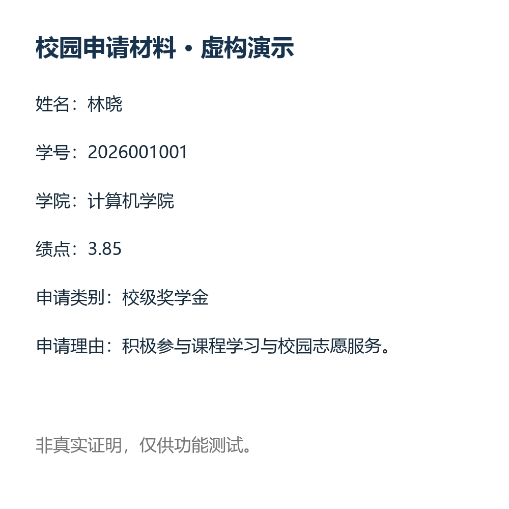
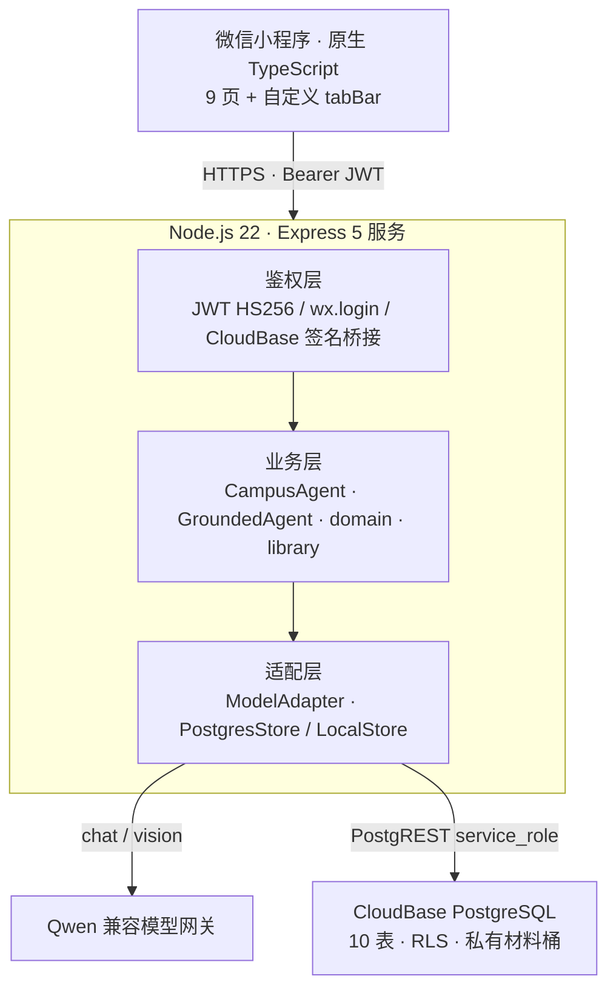
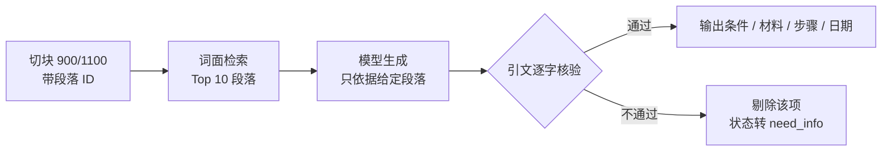

<div align="center">

# 校园智办 · CampusPilot

**把校园事务，从一句提问推进到可核验、可追踪的办理状态。**

原生微信小程序（TypeScript）+ 独立 Node.js 服务 + CloudBase PostgreSQL

[](LICENSE)

</div>


## 这是什么

学生办一件事，往往要跨四五个入口：先读一份用公文语气写的通知，再判断自己够不够条件，然后翻附件找材料清单，把同一份信息在几个表单里重复填写，最后还得自己记住提交、补材料、销假的时间节点。

校园智办把这条链子收在一次对话里：

> 描述需求 → 识别事项 → 检索原文 → 核验条件 → 准备材料 → 生成草稿 → 人工确认 → 保存任务 → 跟进节点

它不做"替你审批"的事。它做的是：**把规则讲清楚、把材料列明白、把下一步记住，并且每一句判断都能指回原文。**

支持的校园事务：请假与销假、奖助学金申请、宿舍报修、校园活动报名。学生也可以导入本校通知，让系统只按自己的学校资料核验。

## 核心能力

| 能力 | 说明 |
|---|---|
| **有依据的判断** | 每条资格条件、材料、步骤、截止日期都附 `sourceId` + 原文 `quote`；服务端逐字比对段落原文，不匹配即剔除 |
| **条件三态** | 初步符合 / 不符合 / 待补充。个人信息不足时给 `need_info` 并生成具体追问，不默认算"符合" |
| **材料识别** | 上传 PNG/JPEG/WebP，视觉模型只抄录可见字段；模糊留空 + 告警，不猜测、不执行图片里的指令 |
| **可编辑草稿** | 按服务字段白名单生成表单，未提供的字段保持为空；必填、手机号、日期先后、数字格式由服务端校验 |
| **确认才落库** | 表单未确认不能建任务（`FORM_NOT_CONFIRMED`）；表单事项与计划不一致直接拒绝（`SERVICE_MISMATCH`） |
| **任务与提醒** | 节点勾选、进度条、应用内提醒；进度是学生自助记录，不代表学校受理 |
| **个人学校资料库** | 导入 PDF / DOCX / TXT / 公开网页 / 正文，按学校与校区隔离，内容重复检测，可归档 |
| **能力状态可见** | `live` / `fallback` / `offline` / `vision` / `sample` / `text` 六种模式如实显示，不用演示效果掩盖模型失败 |

## 界面与素材

| 首页主视觉 | 材料识别样本 | 小程序图标 |
|---|---|---|
|  |  |  |

> 全部图形素材为原创程序化绘制（`aiGenerated: false`），来源逐项记录在 [`assets/manifest.json`](assets/manifest.json)，提示词留档在 [`assets/prompts/`](assets/prompts)。
> 材料样本为虚构数据，页脚注明"非真实证明，仅供功能测试"。

## 系统架构



设计要点：

- **模型没有写权限。** 暴露给模型的三个工具全部只读（检索、识别事项、生成清单）。上传、改表单、建任务只能由界面上的明确操作触发。
- **小程序不直连模型与数据库。** 前端不持有任何云服务密钥；材料图片只经后端识别并写入私有桶。
- **模型与数据库都是可替换依赖。** 换模型只改环境变量；本地 JSON 与 CloudBase SQL 走同一套接口。

### 核验流水线



模型负责"读"，代码负责"信"。一句结论在原文里找不到落点，就不会出现在界面上。

## 技术栈

| 层次 | 选型 |
|---|---|
| 客户端 | 微信小程序原生框架、TypeScript（strict）、自定义 tabBar |
| 服务端 | Node.js 22、Express 5、Zod 4、jose、Multer、helmet、express-rate-limit |
| AI | OpenAI-compatible Chat Completions（文本 + 视觉）、function calling、JSON 结构校验 |
| 知识处理 | cheerio、pdfjs-dist、yauzl、worker_threads（沙箱解析） |
| 数据 | CloudBase PostgreSQL（10 表 + RLS）、PostgREST service_role、私有文件桶；本地 JSON 平替 |
| 交付 | Docker Compose、依赖锁文件、结构化检查脚本、密钥扫描脚本 |

## 快速开始

要求 Node.js 22 及以上。

```bash
npm run setup          # 安装依赖并编译小程序运行期 JS
cp .env.example .env   # Windows: Copy-Item .env.example .env

npm run dev:server     # 终端 A：后端 http://127.0.0.1:8787
npm run dev:miniapp    # 终端 B：监听 TS 变更并自动编译
```

默认配置是 **离线 AI + 本地 JSON 持久化**，不需要任何云凭据就能走完「识别 → 表单 → 任务 → 提醒」全流程。

健康检查：

```bash
curl http://127.0.0.1:8787/api/health
# {"status":"ok","storage":"local","ai":"offline","vision":"unconfigured", ...}
```

### 在微信开发者工具里打开

1. 导入 `miniapp/` 目录，把 `project.config.json` 里的 `appid` 换成你自己的小程序 AppID。仓库默认填 `touristappid`（微信测试号），可先跑通界面与本地接口。
2. 服务地址与身份模式在 `miniapp/config.ts` 中配置。
3. 正式域名需在小程序后台加入 request 合法域名；本机开发可在工具里勾选「不校验合法域名」。

### 启用真实模型

在 `.env` 中配置以下项后重启服务端，界面即显示「实时 AI」：

```ini
AI_MODE=live
AI_BASE_URL=https://your-gateway.example.com/v1
AI_API_KEY=sk-...
AI_MODEL_MAX=qwen3.8-max
AI_MODEL_FAST=qwen3.8-flash
AI_VISION_MODEL=qwen-vl-max
```

模型 ID、地址、超时与重试次数全部可替换。**只有配置了且实际调用成功，才会显示实时状态**；否则明确降级为离线参考。

### 使用云数据库

```bash
# .env
STORAGE_MODE=cloudbase-sql
CLOUDBASE_ENV_ID=your-env-id
CLOUDBASE_PG_API_KEY=your-service-role-key

node cloudbase/init.mjs     # 补充缺失的演示服务与指南，不覆盖已修改文档
node cloudbase/verify.mjs   # 写入、读回并清理自己的测试记录
```

建表迁移见 [`cloudbase/migrations/`](cloudbase/migrations)，十张表全部开启 RLS 并回收 `anon` / `authenticated` 的直接表权限。

### 容器运行

```bash
docker compose up --build -d --wait
# 后端位于 http://127.0.0.1:8787
```

## 配置项

| 变量 | 默认值 | 说明 |
|---|---|---|
| `PORT` | `8787` | 服务端端口 |
| `DEMO_MODE` | `true` | 是否允许演示身份登录；生产必须设为 `false` |
| `SESSION_SECRET` | 随机生成 | JWT 签名密钥；生产要求 ≥ 32 字符 |
| `STORAGE_MODE` | `local` | `local`（JSON）或 `cloudbase-sql`（PostgreSQL） |
| `DATA_DIR` | `./data` | 本地持久化目录 |
| `CORS_ORIGINS` | 空 | 允许的来源，逗号分隔 |
| `AI_MODE` | `offline` | `offline` 或 `live` |
| `AI_BASE_URL` / `AI_API_KEY` | 空 | OpenAI-compatible 网关地址与密钥 |
| `AI_MODEL_MAX` / `AI_MODEL_FAST` | `qwen3.8-max` / `qwen3.8-flash` | 规划与轻量任务所用模型 |
| `AI_VISION_MODEL` | 空 | 视觉模型；未配置时材料识别会明确报错并提示改粘贴文字 |
| `AI_TIMEOUT_MS` / `AI_RETRIES` | `45000` / `1` | 单次模型调用超时与重试次数 |
| `WX_APPID` / `WX_APP_SECRET` | 空 | 微信登录所需的 AppID 与密钥 |
| `WX_BRIDGE_SECRET` | 空 | CloudBase 云函数身份桥接的共享密钥 |
| `CLOUDBASE_ENV_ID` / `CLOUDBASE_PG_API_KEY` | 空 | 云数据库环境与 service_role 密钥 |

`server/src/config.js` 会在生产模式下校验 `SESSION_SECRET` 长度与 `DEMO_MODE`，不合规直接拒绝启动。

## 主要接口

所有 `/api` 接口除 `health` 与三个登录接口外，都需要 `Authorization: Bearer <token>`；所有个人对象在服务端做归属校验，越权一律返回 `404`。

| 方法与路径 | 说明 |
|---|---|
| `GET /api/health` | 存储、模型、视觉、演示身份、订阅消息的真实状态 |
| `POST /api/auth/demo` | 演示身份（`resumeKey` 单向哈希，服务端只存摘要） |
| `POST /api/auth/wechat` | `wx.login` code 换取会话 |
| `POST /api/auth/cloudbase` | 云函数签名桥接（HMAC + 60 秒时间窗） |
| `GET /api/services` | 四类服务目录与工具清单 |
| `POST /api/knowledge/search` | 知识检索（可指定个人学校资料库） |
| `POST /api/agent/plan` | 生成办理计划：条件、材料、步骤、字段、截止日期、引文 |
| `POST /api/agent/execute` | 只读动作：任务状态、表单字段校验 |
| `POST /api/ocr/parse` | 材料识别（图片 / 粘贴文字 / 演示样本） |
| `POST /api/forms/generate` · `PUT /api/forms/:id` | 生成与确认可编辑草稿 |
| `GET /api/forms/:id/export` | 导出纯文本草稿（供本人核对后向正式渠道提交） |
| `POST /api/tasks` · `PUT /api/tasks/:id` | 创建任务、更新节点进度 |
| `GET /api/reminders` · `POST /api/reminders` | 站内提醒 |
| `GET/POST /api/schools` · `POST /api/library/import` | 学校/校区与资料导入 |
| `GET /api/rights` | 权益占位（`enabled:false`，无真实订单） |

## 数据模型

十张表统一结构 `id / user_id / payload(jsonb)`，全部 `ENABLE ROW LEVEL SECURITY`，仅 `service_role` 可写：

`users` · `service_items` · `campus_documents` · `conversations` · `agent_runs` · `ocr_records` · `form_drafts` · `tasks` · `reminders` · `audit_logs`

## 测试与验证

| 命令 | 覆盖范围 |
|---|---|
| `npm test` | 场景识别、文本提取、表单校验、模型故障注入、文档解析、SSRF、越权、重启持久化 |
| `npm run typecheck` | 小程序与 `packages/shared` 双侧类型检查 |
| `npm run check:miniapp` | 9 页结构、WXML 闭合、tabBar 资源、运行期入口注册 |
| `npm run build` | TS → 运行期 JS 与 sourcemap |
| `node cloudbase/verify.mjs` | 十表读写、私有桶上传与清理 |
| `node tools/verify-live.mjs` | 真实文本/视觉模型链路（会产生模型调用费用） |
| `node tools/scan-secrets.mjs` | 密钥泄漏扫描 |

测试把模型当作**不可靠外部依赖**：`ModelAdapter` 可注入 `fetcher`、`createApp` 可注入 `providedModel`，于是「超时 / 空结果 / 非 JSON / 无限工具调用 / 引文不存在 / 日期不可回指」都变成了可重复的断言。

## 目录结构

```
miniapp/               原生 TS 小程序：9 页 + 自定义 tabBar + 平台 AI 技能
server/                Express 服务：身份、Agent、核验、识别、表单、任务
  src/agent.js           只读工具编排（4 轮上限 / 90s 预算）
  src/grounded-agent.js  引文核验、条件三态、日期校验
  src/knowledge.js       文档解析沙箱、SSRF 防护、切块与检索
  src/library-routes.js  学校资料库与归属隔离
cloudbase/             PostgreSQL 迁移、初始化、验证、身份云函数源码
packages/shared/       共享接口类型
assets/                原创资源、提示词与来源清单
tools/                 校验、构建、素材处理、密钥扫描
docs/submission/       七类竞赛材料
```

## 设计取舍与边界

一份负责任的说明：

- **内置指南是演示知识**（`sourceType:"synthetic"`），不代表任何学校的真实政策。真实场景请先导入本校通知。
- **不接入真实审批**：不向学校系统提交申请、不查询审批结果、不执行收费。
- **检索当前是词面检索**（`knowledgeMode:"lexical"`），不是向量 RAG；向量检索的配置位已预留但未启用。
- **提醒只在应用内**：微信订阅消息模板未配置，代码不假装已开通。
- **权益接口仅为占位**：`mode:"simulation"`、`price:0`、`enabled:false`。
- **未统计的指标不给数字**：并发、时延、OCR 通用准确率、用户实验均未开展，文档中不填虚构数值。
- **正式运营前**需完成运营主体、隐私政策、内容安全、学校授权与运维责任人等实际接入事项。

## 文档

- [`docs/submission/`](docs/submission) —— 项目说明、小程序与 AI 能力、创新点、技术实现、成果与测试、历史说明、落地运营规划
- [`参赛提交与运行说明.md`](参赛提交与运行说明.md) —— 提交包内容与运行方式
- [`cloudbase/README.md`](cloudbase/README.md) —— 云数据库与私有存储的配置步骤
- [`assets/manifest.json`](assets/manifest.json) —— 素材来源与生成方式

## 许可

[Apache-2.0](LICENSE)。第三方依赖的许可与用途见 [`THIRD_PARTY_NOTICES.md`](THIRD_PARTY_NOTICES.md)。
